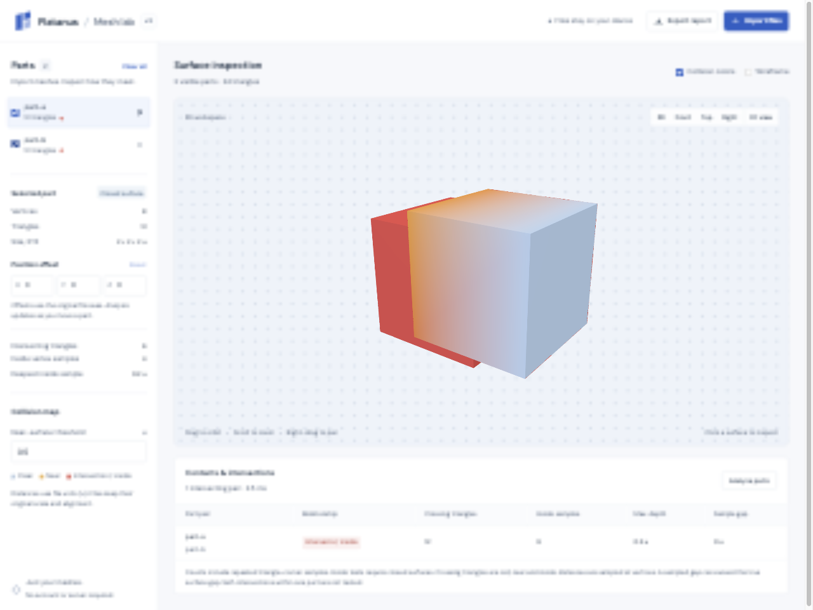

# Platanus v2 · Implant planning

See [the planning workflow and reproducible local evaluation](docs/assistant-workflow.md) for resumable stage records, protected corrections, source/appearance hashes, separate component exports and measured fitting tradeoffs. `node --experimental-strip-types scripts/evaluate-planning-case.mjs --help` describes explicit local case inputs. Optical planning concepts do not require tomography.

A reusable patient-planning workspace for upper, lower and bite intraoral scans. Local geometry and optional mapped colour feed automatic tooth-region proposals, AI-assisted FDI identification and reviewable care planning. Supported scanned gaps and reviewed implant sites produce three separate editable concept meshes: fixture, abutment/pilar and crown. Starts empty; import each patient’s files.



The screenshot uses two uploaded test meshes. No model is bundled or loaded automatically.

## Run

Requires Node.js 24+ and pnpm.

```sh
pnpm install
pnpm dev
```

Open **http://localhost:5175**. Import, rendering, tooth identification, and collision inspection work without credentials or external APIs.

Import upper/lower scans, bite captures and companion textures together. Bite refinement automatically considers every capture, including hidden references, and checks each proposed step against the same frozen-sample limits as the final result. Small per-capture increases can remain within tolerance even when overall agreement improves; the alignment table reports them. If no acceptable refinement is found, the current pose stays available for inspection, with the reason under **Alignment details** and visual bite review still pending. Confirming unchanged scan-role suggestions preserves the fitted pose and its measurements.

## Local CBCT tomography

Open **Tomography → Import folder** or **Import DICOM files** to load a local, already reconstructed slice series. The app starts empty. Patient files and the sibling application are not bundled or modified. Import, reslicing, and the skull/bone surface preview run locally; no imaging service or new environment variable is required.

- **Supported input:** ordinary single-frame monochrome 8/16-bit integer DICOM Part 10, native implicit/explicit little endian or explicit big endian. Compressed, deflated, enhanced/multiframe, sheared, inconsistent or over-budget acquisitions fail explicitly. A folder with several series offers an anonymous series selector. Files are ordered by patient-space geometry, not filenames. Position, direction, physical pixel spacing, stored bits, signed values, rescale and padding are respected. Only a DICOM-declared HU rescale type is labeled HU; it does not validate CBCT density.
- **Missing data:** incomplete input is rejected by default. **Allow incomplete preview** omits unreadable files and preserves missing planes as unavailable (`NaN`); it never invents slices. The supplied development acquisition has six missing planes and can only be used as a nonquantitative preview. Missing and out-of-volume pixels appear as blue checkerboard. Measurements remain disabled, even after visual alignment review.
- **3D reference:** adjustable intensity threshold and explicit preview stride produce a cancellable, bounded scalar isosurface, not anatomical segmentation. Default stride 4 is a coarse display preview; effective spacing is shown. The original voxel volume is retained for slices. Extraction exceeding 600,000 triangles fails with a request to choose a coarser stride; quality is never silently reduced. Import is bounded to 512 MiB, 4,096 files and 64 million voxels. Files and voxel buffers stay in memory and are released on clear/reload.
- **Slice review:** linked axial, coronal and sagittal LPS views, an optional oblique plane, crosshair coordinates, grayscale window and physical zoom use the original volume. Initial contrast uses a bounded sampled percentile range for display only. Complete acquisitions support manual two-point distances in millimeters. A picked-point distance is not automatic bone depth, density, a nerve/sinus boundary or implant clearance.
- **Superimposed 3D view:** **Scan scale** visibly defaults to **1 mm per file unit**, as requested, and remains editable. Import local scans and a CBCT in either order; after any automatic bite refinement finishes, jaw-region alignment starts locally in a cancellable worker. The fit matches shared dental anatomy in the CBCT jaw region using a bounded registration target, independently of the displayed reconstruction. One rigid transform moves every imported scan and hidden bite reference together, preserving their shared pose without inferred scaling or deformation. Separate opacity controls show the scans against the translucent CBCT. **Reset alignment** restores the pre-fit poses; cancel, reset, and manual pose edits stop automatic retries for that input. New sources, a new volume, or a changed scale can start another automatic fit; **Align model to CBCT** also retries manually. Source, pose, volume, or scale changes cancel stale fitting and invalidate the applicable review. Distances remain labeled in file units; the default conversion is an editable assumption, not a physical calibration.
- **Alignment review:** the automatic fit is a visual estimate against a threshold surface, with sampled RMS, median distance and the fraction of compatible samples within 1 mm. Shape-selected crown support is reported separately; whole-scan metrics also retain gums and palate. The bounded native surface target reports its sampling cell size and leaves display resolution unchanged. These are surface-fit metrics, not contact area, overlap volume, or a clinical registration certificate. Poor support fails explicitly; **Landmarks & slices** provides a fallback using at least three well-spread corresponding tooth landmarks from the 3D probe and slice crosshair per arch. Inspect corresponding anatomy in several planes before marking the **visual** alignment reviewed. CBCT acquisition pose may differ from the recorded bite; a shared rigid fit cannot correct jaw articulation or deform the mandibular bone.
- **Restoration overlays:** reviewed arches enable actual triangle–plane intersections of the currently posed fixture, pilar and crown, with component colors and an assembly-focus control. These are geometrical contours through the central plane, not a simulated radiograph. The generated mesh follows its parent scan. Threshold references and bite captures do not enter optical collision analysis.

**AI images are opt-in.** The case assistant can inspect a selected rendered slice or current 3D capture using `getTomographyInventory` and `inspectTomographyView`. `requestTomographyView` can ask the browser for an exact additional LPS plane, field of view and contrast, then resume with the actual image. Sharing is bounded to eight JPEGs, 1.5 MiB each and three additional view rounds. Reviewable thumbnails include exact pixel axes, projection, window, source completeness, current component transforms and registration status. Raw DICOM, voxel buffers, original filenames and patient metadata are excluded. The case assessment has a separate **Include the current tomography slices and 3D capture** checkbox; its evidence IDs use `tomography:view-N`, separately from optical views. These images support visual review and conditional design hypotheses; they do not automatically establish bone-safe fixture dimensions or let the chat tools modify geometry.

Tomography volumes and visual registration review are not embedded in the existing mesh case-session format. Retain and reimport the source DICOM; repeat registration review after reopening. Saved mesh poses still use the existing source-to-workspace transforms.

## Patient planning workflow

The default screen is the patient model and one process panel. It starts empty. Add local files, then use **Start AI workflow** or **Start local workflow** once. Assessment, supported concept generation, fitting and surface checks continue automatically. Findings and review annotations do not require approval clicks. Start authorizes up to two provider requests when AI is configured: planning and a final review of completed local work:

1. **Prepare evidence.** Local workers inspect imported geometry, mapped colour and scan coverage; suitable bite references refine the pose automatically. Filename roles remain hypotheses without being marked user reviewed. Role, patient-side and bite corrections are optional advanced tools. A scan with no usable arch role or malformed geometry still needs correction; missing geometry is never invented.
2. **Create the plan.** Starting an AI workflow explicitly shares rendered views and anonymous case measurements with Anthropic. Raw meshes and notes stay local. Optional CBCT sharing remains off until selected. Without a configured provider or usable images, a local geometry assessment is clearly attributed. Resume uses retained evidence or a local assessment without making another provider request.
3. **Create implant concepts.** Supported bounded scan gaps can generate automatically even when patient side and anatomical FDI remain unknown. These appear as **Upper draft site** or **Lower draft site**. An illustrative crown template selects anatomy only; its template FDI never establishes patient identity or a reviewed missing-tooth record. Optional identity correction and skip controls live in advanced site details. Reviewed positions and manual mode remain available. Unlocalized gaps, missing geometry and chart conflicts remain visible; an empty generation queue never claims an implant was created.
4. **Place and fit concepts.** Generated components automatically appear in their parent scan's current pose. The process shows actual worker construction and fitting phases. Bounded local fitting retains the best measured candidate. This is a visual concept; bone-safe fixture placement, implant-system compatibility and clinical fit remain unassessed.
5. **Review the draft.** Fresh collision analysis follows generation. The review state distinguishes pending measurements, paused work, errors, stale concepts and unresolved questions. Distances use source file units; sampled surface distances and triangle intersections do not measure exact contact area or overlap volume. When the planning assessment used AI, a second read-only AI review follows the fresh measurements, using anonymous component aliases, bounded fitting summaries and any opted-in CBCT views. It cannot edit geometry or certify clinical safety. Interrupted or failed AI reviews keep local results and never turn partial text into a completed review. Clinical review remains pending after automatic checks finish.

**Pause workflow** retains completed artifacts. Resume restarts interrupted preparation, or resumes final surface checks without repeating planning and generation. Stopping a final AI review retains local checks; resume does not retry that paid request. A new explicit workflow starts a fresh review attempt. **Advanced tools** opens evidence, findings, component adjustments, correction tools and the workflow record. Camera and scene controls are collapsed in the viewer; **Files** opens scan roles, textures, opacity and manual offset/reset. **CBCT** opens local volume and registration tools; the fitter uses optical surface evidence, so including tomography does not establish a bone-safe implant plan.

Use **Workflow model** in the main process panel to choose **Haiku 5.5**, **Sonnet 5.5**, or **Opus 5.5** before starting. It stays in sync with **Case assessment model** in Advanced tools. The selected model handles the next assessment and its final AI review; changing the selection preserves completed results and their model attribution. Selection is locked while the workflow is processing.

Save a resumable case or export components and a manifest from the review panel, including partial drafts and unresolved questions. Component PLY files use source coordinates; their manifest carries the parent transform. Reopen verifies reimported scan geometry and available source/appearance hashes. Retain the original scans and textures.

This is a general workflow, with no patient files, scanner-specific template or hardcoded models bundled. It accepts geometry-only STL, vertex-coloured PLY/OBJ, and UV-mapped textured PLY/OBJ. Per-face PLY `texcoord` lists and `TextureFile` comments are supported. Pairing uses explicit local references or unique basenames, never remote texture fetches. Use **Attach texture** to add an atlas after importing a mesh. Without valid UVs it remains an unmapped reference; the app never guesses where atlas patches belong. Black atlas padding supplies no tissue evidence. Sampled pinkness is only an optional gingiva boundary cost; geometry remains authoritative and colour is not a diagnosis. Existing labels and manual exclusions remain protected.

The planning endpoint starts with `ANTHROPIC_PLANNING_MODEL` (default `claude-haiku-5-5`); the selector overrides it for the next assessment. It uses the same server-only key as identification/chat. Completed assessments retain their actual model attribution, and model selection is locked while processing. It reads the repository’s dental-restoration-design skill and clinical reference. It allows one assessment at a time, at most eight reviewed optical JPEGs plus the explicitly shared current tomography views, 12 MiB JSON, 1.5 MiB per image and 90 seconds. Provider failures and case changes preserve existing labels. Local evidence preparation is bounded; up to six source overviews plus whole-case views are sent, so fragmented sources without a view remain unknown. Model status indicates configuration, not guaranteed access. There are no patient database, accounts or background uploads. Deployment of the static bundle alone cannot serve the AI endpoints; use the local dev/preview server or implement protected hosted equivalents.

Planning errors distinguish output-limit truncation, provider refusal, invalid or empty structured responses, rejected credentials, model access, rate limits and provider unavailability. These messages use fixed text; provider error bodies, case evidence and credentials are never forwarded or logged. The generation budget remains 8,192 output tokens with no automatic provider retries. An output-limit error confirms truncation; the generic fallback alone does not establish a token-budget or quota problem.

A visual concept can support discussion before a clinical workup. It does not diagnose disease, prescribe cleaning/restoration/implant treatment, establish bone-safe depth or trajectory, encode a compatible manufacturer interface, or establish manufacturing readiness. The three-part generator deliberately supplies smooth envelopes without threads, connection fit or screw access. The generic abutment envelope spans a nonzero fixture-platform depth; this visual continuity is not a compatible implant connection. Physical unit calibration, clinical history/examination, appropriate imaging and reviewed registration, component library identity and fit remain separate evidence. See [`skills/dental-restoration-design/references/component-parameters.md`](skills/dental-restoration-design/references/component-parameters.md) for parameter meanings and researched component distinctions.

## Optional Anthropic case assistant

Open **Ask about this case** below the inspection results. The function catalog and exact outgoing summary are visible before sending a question. Chat uses Vercel AI SDK 7 and the direct `@ai-sdk/anthropic` provider, with streamed answers and read-only function calls.

To enable answers, copy `.env.example` to `.env.local`, set `ANTHROPIC_API_KEY` there, and restart `pnpm dev`. `ANTHROPIC_MODEL` defaults to `claude-sonnet-5-5` and can select another tool-capable Anthropic model your API account supports. Never use a `VITE_` prefix for API credentials. The key is read only by the local server.

Use **Case chat model** to choose **Haiku 5.5**, **Sonnet 5.5**, or **Opus 5.5** for the next question. The server validates the choice and routes the request to that model; each answer records the model actually used. The selector is locked while an answer is running. Model changes preserve the conversation. `ANTHROPIC_MODEL` supplies the initial/default choice, and an explicitly configured model outside the three presets remains available as a server-default option. The three current model IDs are documented in [Anthropic's model overview](https://platform.claude.com/docs/en/models/overview).

`pnpm build && pnpm preview` also serves the assistant API. These are local dev/preview middleware endpoints, bound to loopback by the existing commands; publishing only `dist/` does not provide chat. A hosted deployment would need its own server endpoint and access controls. No conversations or patient cases are saved by this app's server.

Each deliberate submission sends the question, recent conversation, and a bounded case summary to Anthropic. The summary contains anonymous scan aliases, geometry metadata, poses, clinician-entered FDI records, site coordinates, and available collision/probe/bite-fit metrics. Raw meshes, vertex arrays, screenshots, original filenames, and scan names are excluded. Tooth notes are excluded by default and have a separate opt-in. Review the summary and keep patient identifiers out of questions and optional notes; aliases do not guarantee de-identification. The provider receives the submitted information under the configured account's terms. Importing or inspecting a mesh alone never invokes Anthropic.

| Function | Why it helps with case review | Evidence and limits |
| --- | --- | --- |
| `getModelInventory` | Check which arches and references are available and which participate in analysis. | Assigned roles, visibility, geometry counts, original file-axis dimensions and manual poses; dimensions are not anatomical measurements. |
| `getToothChart` | Review recorded missing positions, crown/implant intentions and unreviewed teeth. | Clinician-entered permanent FDI records and assigned surface counts; unlabeled does not mean missing. |
| `inspectImplantSite` | Check what is recorded at a proposed FDI site and what evidence is still missing. | Status, restoration intent and optional surface marker; a marker is not an implant axis or bone measurement. |
| `getCollisionReport` | Explain intersections and nearby surfaces in the supplied pose. | Whole-scan sampled gaps/depths and flagged triangles; no tooth-specific attribution, exact contact area, overlap volume or proof of clearance. |
| `getBiteFitReport` | Review per-reference fit changes and detect movement after the saved fit. | Sampled RMS and matching coverage for the saved static refinement; no jaw-motion simulation or clinical accuracy claim. |
| `inspectSurfaceProbe` | Explain the surface corner selected in the viewer. | Workspace position, sampled signed distance and triangle intersection state; not the exact click or a periodontal measurement. |
| `measureSiteDistance` | Compare two clinician-marked site points without losing the shared coordinate system. | Straight-line distance between transformed markers in file units; not ridge width, prosthetic space or anatomical clearance. |
| `getPlanningChecklist` | Organize missing scan roles, unreviewed records, site annotations and supporting evidence. | A data-completeness checklist; never surgical clearance or approval. |
| `getDentalDesignGuidance` | Retrieve the dental skill's clinical, geometry, concept-kit, SDK, or source references. | General design knowledge with citations; separate from observations of the current case. |

All distances remain **file units (`u`)**, with no silent conversion to millimeters. The assistant can see only explicitly shared rendered images returned by its image tools; it cannot infer anatomy from a filename. Surface meshes alone cannot establish bone quantity/quality, nerve/root/sinus clearance, implant dimensions/trajectory, suitability, periodontal disease or a safe surgical plan. The assistant is for explaining geometry and recorded observations. Clinical examination and appropriate reviewed imaging remain separate inputs; see the [ADA–AAOMR imaging recommendations (2026)](https://health.ri.gov/sites/g/files/xkgbur1006/files/2026-01/ADA-AAOMR-patient-selection.pdf).

Answers include expandable function inputs/results. Workspace or sharing-setting changes cancel an active request and clear previous answers to avoid using stale measurements. **Stop answer** cancels the upstream stream; failures are marked incomplete and excluded from subsequent answer history. Requests have bounded input/history, a six-step tool loop, a 90-second timeout, and a two-request local concurrency limit. Tools inspect existing local analysis; they do not launch expensive geometry work or change scans/annotations.

Implementation references: [AI SDK direct Anthropic provider](https://ai-sdk.dev/providers/ai-sdk-providers/anthropic), [AI SDK tool calling](https://ai-sdk.dev/docs/ai-sdk-core/tools-and-tool-calling).

## Dental restoration design skill

The reusable [dental-restoration-design skill](skills/dental-restoration-design/SKILL.md) combines a clinical reference, a geometry/evidence workflow, and a deterministic crown-exterior kit. Its [source register](skills/dental-restoration-design/references/sources.md) covers fixture depth and size, restoration-driven placement, emergence, proximal contacts, static and dynamic bite, imaging, compatible components, and manufacturing requirements. The [design rationale](skills/dental-restoration-design/references/design-rationale.md) explains the architectural lessons taken from the requested anatomy skill.

[Tooth-model reference research](docs/tooth-model-references.md) compares natural scan datasets, educational anatomy and CAD libraries, records their reuse terms, and documents the tested anatomy and donor-conversion improvements.

The existing AI SDK assistant loads the main instructions and retrieves references through `getDentalDesignGuidance`. It still receives only the bounded metadata summary and provides read-only guidance. Mesh construction is available to a local coding agent through the kit; it is not an in-app chat function. [The SDK contract](skills/dental-restoration-design/references/ai-sdk-integration.md) describes how a future worker-backed geometry tool must preserve source/pose/site revisions and cancellation.

```sh
node --experimental-strip-types skills/dental-restoration-design/scripts/inspect-scans.mjs --help
node --experimental-strip-types skills/dental-restoration-design/scripts/generate-concept.mjs --help
node --experimental-strip-types skills/dental-restoration-design/scripts/generate-donor.mjs --help
```

See the [kit instructions](skills/dental-restoration-design/references/concept-kit.md) for input/output and the explicit JSON schema. No new dependencies or environment variables are required. All dimensions stay in file units; physical scale must be independently confirmed. The generated PLY is an editable, parameterized **exterior concept**, with an artificial basal cap. Fixture placement, abutment/connection, inner fit, material thickness, and clinical/fabrication release require separate evidence and review. Upper/lower/bite surface scans alone do not establish bone or a safe fixture depth.

Local case exercises and their derived artifacts belong in the ignored `work/dental-skill-evaluation/` directory. The skill contains no bundled patient meshes and never automatically loads a case into the workspace.

## Inspect a model

1. Import or drop one or more **STL, OBJ, or PLY** files. Disconnected shells become separate parts. OBJ objects retain their grouping.
2. Choose **Orbit** or **Pan** for left-drag / one-finger movement. Right-drag pans in either mode; two fingers pan and zoom. Scroll zooms toward the cursor, with **+ / −** buttons available. **Focus selected** frames one scan and **Fit all** frames visible scans without resetting the viewing angle. Double-click a surface to make it the orbit pivot. With the canvas focused, **F** fits all, **Shift+F** focuses the selected scan, and **Escape** returns to Orbit. The **Z up / Y up** control changes the viewing convention without changing file coordinates.
3. With at least two visible parts, collision analysis runs automatically and **Collision colors** starts enabled. Amber is near another surface, red marks intersecting triangles, and deeper red marks vertices inside a closed part. Highlights stay visible over textures and lighting; unmarked surfaces retain their natural appearance. Toggle **Collision colors** off to hide these highlights.
4. Select a part to inspect its geometry and edit its **X/Y/Z offset**. Colors and results update after each edit. Wireframe helps reveal internal surfaces.
5. Adjust the selected scan’s **Model opacity** to see collision colors through surrounding surfaces. **Fade others** keeps the selected scan solid and shows the others at 20%; **Reset opacity** restores solid meshes and the default 35% bite references. Opacity only changes rendering: visible arches stay in collision analysis, even at 0%, and existing results are retained.
6. Click a surface to inspect its nearest triangle corner: coordinates, signed distance, and whether its triangle intersects another part.
7. **Export report** saves the current settings, part metadata, offsets, display opacity, and pair metrics as JSON. Files are kept in memory; reloading clears the workspace.

## Identify teeth and missing sites

The primary Evidence step automatically prepares the whole case. The following controls are available under **Identification details & manual corrections** for an individual source.

1. Import **STL, OBJ, or PLY** scans and confirm their **Upper arch / Lower arch** roles. In the correction panel, **Rerun** scans the selected part; **Scan imported arches automatically** optionally enables repeated scanning on part selection. Detection settings provides sensitivity and an occlusal-axis override for unusual scan orientations. No scan or image is uploaded during local detection.
2. The scan displays anonymous **C1, C2, …** candidate regions. These IDs describe geometry, not tooth numbers. **Pick detected tooth** selects a region directly in 3D; **Use region for FDI …** assigns it to the displayed FDI target without tracing (its mapped identity when available). Existing surface assignments remain protected. Candidate masks are conservative and can omit cervical margins or split/merge unusual surfaces.
3. For automatic FDI identification, configure the server-only `ANTHROPIC_API_KEY` in `.env.local`. `ANTHROPIC_TOOTH_MODEL` defaults to `claude-haiku-5-5`, independently of the optional chat model. Restart dev/preview after configuring. **FDI identification model** offers Haiku 5.5, Sonnet 5.5, and Opus 5.5 for the next identification. It uses the [Vercel AI SDK structured-output flow](https://ai-sdk.dev/docs/ai-sdk-core/generating-structured-data) and the existing direct Anthropic provider. Selection is locked during processing; previous suggestions retain their actual model attribution.
4. Choose **Prepare scan views**. Four fixed views are rendered locally with candidate labels; the current viewport and poses are preserved. Confirm whether patient right is image left or right in the first overview. File coordinates cannot establish patient laterality. **Review exact upload payload** shows the chosen model, images, and anonymous region summaries. **Identify FDI with [selected model]** deliberately sends those images and summaries to Anthropic; filenames, tooth notes, raw geometry, and other case data are excluded from this request. It uses the configured API account and its usage charges.
5. The selected model suggests candidate-to-FDI mappings and may leave uncertain identities unresolved. **Apply mapped teeth** accepts the eligible mappings together as one undoable edit. Existing tooth masks, explicit exclusions, and reviewed Missing/Not scanned records are preserved. User-corrected mappings survive model retries; conflicting model suggestions become unresolved. The model cannot invent triangle indices or directly mutate the chart. Regions are never numbered by counting through a gap. Possible missing/unsegmented suggestions stay separate from the chart until reviewed; **Review FDI …** only selects that position.
6. Use **Correction tools** for exceptions: Add brush / Erase / Exclude gum, or at least three Boundary points plus a Crown seed and **Preview region → Assign preview**. Navigate/Orbit/Pan rotates the scan; Escape leaves editing. Brushes follow approximate routes across exact shared edges and apply on release. Erase affects this tooth and explicit exclusions, preserving other tooth labels. Invalid or nonseparating boundary loops leave labels unchanged. Undo/Redo retain up to 20 edits.
7. **Isolate tooth / preview** hides the surrounding surfaces. It is a presentation mask: collision results still compare complete visible non-reference scans. In Inspect mode, enabled collision colors appear above tooth labels; while editing, label colors take priority so the active tool stays readable. Assignments retain their original triangles through offsets, rotations, and bite refinement.
8. Review positions as **Present**, **Missing**, or **Not scanned**. Zero assigned triangles never means missing. Patient right is on the odontogram's left; missing teeth keep their original numbers. Clear existing labels before marking a tooth Missing or Not scanned. Missing sites can have a scan point, a note, and Implant review intent; present teeth can have Crown review intent. These records and AI suggestions do not establish treatment need, an implant axis, dimensions, or bone assessment. Accepted identification feeds the patient-planning workflow; candidate naming alone does not generate fitted restorations.
9. **Save identification** downloads accepted labels, chart records, notes, and source-coordinate site points. To resume, import the same original arch files, assign matching roles, and **Load identification**. Loading verifies geometry and triangle order and rejects ambiguous duplicate scans or conflicting records. It keeps current poses; saved transforms are reference metadata. JSON contains no mesh files. Unaccepted proposals are temporary and are recomputed after reimport. Removing a source clears affected labels/markers and undo history; removing an entire arch clears its reviewed records.

Automatic detection uses area-weighted PCA, local persistence-branch support, and an edge-geodesic watershed in a worker. Local shoulder support calibrates prominence, spacing and bounded growth; capped orientation contributions reduce domination by one broad palate basin. It inspects both occlusal signs and preserves original face indices. It supports up to **1,000,000 triangles per part**, has an internal **8-second** budget, and the per-part correction worker is terminated after **30 seconds**. Whole-case preparation has a **90-second** overall detection budget. Axis and scale are inferred from shape, not assumed from millimetres or file axes. It is a geometric heuristic, not a trained dental segmentation network. Synthetic tests exercise multiple crowns, missing gaps, noise, disconnected shells, scale, rotation, and large origins; clinical accuracy on arbitrary real scans is not established. Flat/edentulous, heavily cropped, noisy, fragmented, restored, and crowded scans may produce no usable regions or require correction. AI naming cannot repair a wrong triangle boundary.

The identification endpoint reports configuration separately from provider reachability, validates candidate IDs and arch-specific unique FDI numbers, and returns unknown identities for omitted regions. It allows one request at a time, limits JSON to **8 MiB**, each JPEG to **1.5 MiB**, and total request time to **90 seconds**. Cancellation or source changes discard stale results. Provider failures leave reviewed labels intact. Hosting only `dist/` supports local detection; Cloud identification requires the local dev/preview middleware or an equivalent hosted server route with protected credentials.

Whole-triangle selection leaves a stepped boundary. It neither cuts new triangles nor closes the isolated crown into a solid. Selection supports up to **1,000,000 triangles per part**, **128 boundary picks**, and **256 picks per brush stroke**, with an internal work budget and a 30-second worker timeout. Work is cancellable, and changing the source/selected tooth cancels stale selection. Brush distances are an edge-midpoint approximation in file units. Identification JSON is limited to **8 MiB** on load.

## Intraoral bite workflow

1. Import **upper**, **lower**, and one or more **bite** files together. The names `upper`, `lower`, `bite1`, and `bite2` suggest roles automatically; confirm or change **Scan role** on each selected part. Other filenames remain ordinary meshes until assigned.
2. Original coordinates are preserved. Bite references appear translucent and are always excluded from collision analysis. Hiding a bite only changes its display; all assigned bites remain registration references.
3. With one upper source file, one lower source file and a bite capture assigned, refinement is attempted automatically once. Components from the same imported file are grouped before registration. Choose **Refine to bite** to retry. The worker refines both arches against fixed bite surfaces from their current nearby pose. **Match radius** is in file units and limits accepted correspondences; this does not provide global registration of unrelated coordinate frames.
4. Review the per-reference sampled before/after RMS, sample count, and matching coverage, then visually inspect both references. Sampling and fitting balance reference scans; a candidate that materially worsens any reference is rejected, leaving both arches unchanged. Accepted transforms become the saved bite pose. Manual XYZ translation and centre-based rotation let you inspect other poses; **Reset to bite** clears manual movement. **Restore file poses** discards registration and all manual movement.
5. Collision results compare visible non-reference meshes. An open intraoral surface can show triangle intersections and sampled gaps, but has no reliable solid interior.

A static bite scan constrains a captured pose. It does not identify a hinge axis or provide a patient-specific jaw-motion simulation. Refinement is a local geometric fit, and sampled RMS error does not establish clinical accuracy. Meshes with little overlap, uncertain arch ownership, or insufficient geometric variation may be rejected. Every bite reference must provide usable patches on both arches. Both arch updates are applied together; failed or cancelled work leaves poses unchanged.

## What the results mean

- Original coordinates and scale are preserved across all files. Distances are in **file units (`u`)**. If your exporter uses millimeters, one `u` is one millimeter. Files must start in a shared or nearby coordinate frame. Explicit bite refinement changes the rigid arch poses; manual offsets use the shared axes and rotations use each posed mesh centre.
- The near-surface threshold controls the amber range. It does **not** turn a nearby surface into a collision.
- Triangle-to-triangle intersection checks include coplanar overlap and touching surfaces. A flagged triangle is colored red in full; this is not an exact contact-patch visualization.
- Every triangle corner is tested against the other part’s **triangle surfaces**, not just its vertices. Corners inside a closed surface receive negative distances. Open meshes still support distance and intersection checks, but do not define a reliable interior.
- Counts refer to **triangle-corner samples**, so shared geometric vertices can appear more than once. Part details also show the unique geometric vertex count.
- Penetration depth is the deepest **sampled vertex-to-surface distance**, not exact solid overlap depth or volume. Interior crossings can occur without any corner inside; triangle intersection checks catch those too.
- `Sample gap` is the smallest absolute corner-to-surface distance. It can exceed the true surface gap. Intersecting surfaces force it to zero; a fully contained part can have a positive sample gap and negative signed distances.
- Only pairs with intersecting triangles, inside samples, or samples within the threshold appear in results. Visibility controls which non-reference parts participate in collisions; bite references never do. Self-intersections within one part are not tested.
- Mesh imports preserve supported UVs and vertex colours, and local atlas files can be paired. Point clouds remain outside this version’s scope. Automatic regions and AI identities are reviewable proposals; clinically validated segmentation is outside this version's scope. Closedness is based on welded geometric edges; malformed or self-intersecting closed meshes can still produce ambiguous interiors.

The workspace accepts up to **64 parts**, **2,000,000 triangles**, and **100 MiB per import batch**. Import preparation runs in a worker. Collision and bite refinement each run in cancellable workers and are terminated by the app after 60 seconds. Bite refinement also has an internal 8-second computation budget and a 750,000-triangle per-scan limit. Dense meshes may need simplification.

## Code map

```text
Local files → import-models.ts → ModelPart[] → viewer.ts → Three.js canvas
                                    ↓
                          collision.worker.ts
                                    ↓
                              collision.ts
                                    ↓
                       distance colors + pair report
```

- `src/import-models.ts`: parsing, validation, connected shells, and closedness.
- `src/collision.ts`: triangle BVH, nearest-surface queries, ray-parity interior checks, and triangle intersections. Pure geometry entry point for experiments.
- `src/collision-input.ts`: applies rigid poses and excludes bite references before collision work.
- `src/pose.ts`: file-role suggestions and shared file-to-workspace transforms.
- `src/bite-alignment.ts`: local rigid refinement against fixed bite surfaces.
- `src/import.worker.ts` and `src/bite-alignment.worker.ts`: background import and registration.
- `src/collision.worker.ts`: background analysis and typed-array results.
- `src/viewer.ts`: navigation, per-model opacity, vertex colors, and picking.
- `src/camera.ts`: projected-bounds framing and stable surface orbit pivots.
- `src/teeth.ts` and `src/tooth-types.ts`: permanent FDI identities, review records, and protected triangle labels.
- `src/tooth-geometry.ts` and `src/tooth.worker.ts`: bounded surface brushes and separating boundary selection.
- `src/useToothIdentification.ts`: annotation history, cancellable selection, and site editing.
- `src/tooth-session.ts`: validated local saves bound to original scan geometry.
- `src/ToothPanel.tsx`: odontogram, surface tools, and missing-site review.
- `src/auto-tooth-geometry.ts` and `src/auto-tooth.worker.ts`: local automatic crown-region proposals.
- `src/useAutoTeeth.ts` and `src/AutoTeethPanel.tsx`: cached proposals, local views, FDI mapping, and explicit acceptance.
- `src/auto-tooth-views.ts`: isolated multi-view JPEG rendering with visible candidate IDs.
- `src/tooth-identification-schema.ts` and `server/tooth-identification.ts`: bounded Vercel AI SDK structured identification with selectable Anthropic models.
- `src/useCasePlanning.ts` and `src/case-evidence.worker.ts`: automatic whole-case evidence; `src/guided-process.ts` and `src/ProcessPanel.tsx`: observable process states; `src/PlanningPanel.tsx`: evidence and review tools on demand.
- `src/case-planning-schema.ts` and `server/case-planning.ts`: evidence-bound structured findings and conditional care planning.
- `src/texture-evidence.ts` and `src/texture.worker.ts`: local UV sampling and optional colour boundary cues.
- `src/scan-groups.ts`: source-file grouping for disconnected bite captures and arch components.
- `src/restoration-site.ts`, `src/restoration-geometry.ts`, and their workers: bounded site hypotheses and three independent component meshes.
- `src/useRestorations.ts` and `src/RestorationPanel.tsx`: provenance, stale-concept invalidation, exports, and optional component tuning.
- `src/App.tsx`: import, scan roles, bite refinement, manual pose controls, and report export (including rigid transforms).
- `src/assistant-context.ts`: bounded, anonymous case summaries and the visible function catalog.
- `src/assistant-tools.ts`: read-only AI SDK function definitions and evidence limits.
- `src/AssistantPanel.tsx`: opt-in chat, sharing controls, tool evidence, cancellation and stale-answer handling.
- `server/assistant.ts`: server-only Anthropic streaming endpoint used by Vite dev and preview.

```sh
pnpm test   # Geometry/import regression tests
pnpm build  # Typecheck and production bundle
```

The original `../platanus` project is independent and is not required to run this one.
