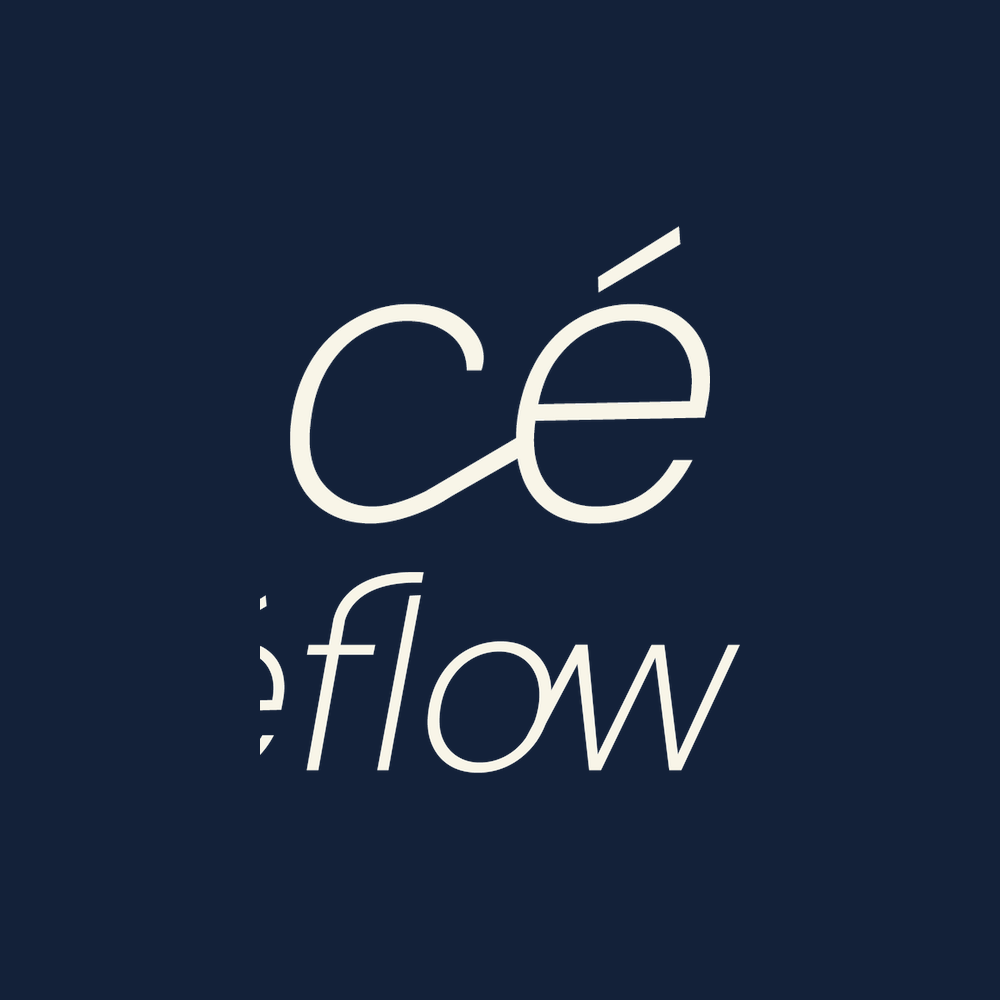

# Céflow · Visualización 3D y Planificación Odontológica Automatizada

<div align="center">



[](https://cenflow-ph.onrender.com)
[](https://cenflow-ph.onrender.com)
[](https://github.com/platanus-hack/platanus-hack-26-ve-team-18)
[](https://github.com/platanus-hack/platanus-hack-26-ve-team-18)

**Revolucionando la planificación odontológica en casos complejos: de semanas a unas pocas horas.**

[🚀 Demo en Vivo](https://cenflow-ph.onrender.com) · [👤 Portal del Paciente](https://cenflow-ph.onrender.com/#patient) · [📋 Documento del Proyecto](project-description.md)

</div>

---

## ⚡ Céflow en 1 Palabra: **Planificación**

> **Origen:** Céflow nace para revolucionar la planificación odontológica en casos complejos, reduciendo procesos de semanas a unas pocas horas. Transformamos mecanismos manuales e ineficientes en flujos digitales de alta precisión.
>
> **Historia:** Al vivir de cerca el tiempo que se pierde en tareas manuales, repetitivas y costosas para proyectar un caso, identificamos una gran oportunidad para transformar la planificación clínica. Unimos la experiencia médica con el desarrollo tecnológico para crear la solución que el especialista siempre necesitó.

---

## 🩺 El Servicio

Céflow es un **servicio de visualización 3D y planificación clínica automatizada**, diseñado específicamente para optimizar y acelerar el flujo de trabajo de odontólogos especialistas.

La plataforma opera **100% en el navegador web** sin requerir servidores GPU dedicados ni licencias privativas de software tradicional. Procesa archivos de escáner intraoral (`.STL`, `.OBJ`, `.PLY`), registros de mordida estática/dinámica y tomografías computarizadas (`DICOM Part 10`), entregando en minutos mediciones milimétricas, detección de colisiones oclusales y una **hoja de consulta médica interactiva para el paciente**.

---

## 💎 Fortalezas Clave

| Fortaleza | Impacto Clínico y Operativo |
| :--- | :--- |
| **Adaptación y visualización a diferentes casos** | Capacidad de evaluar arcadas completas, mordidas cruzadas, implantes unitarios o múltiples y tomografías óseas CBCT en un solo visor unificado. |
| **Eficiencia operativa y ahorro de costos** | Adelanta hasta el **80% del trabajo manual repetitivo** de trazado y ajuste, eliminando licencias CAD de más de $15.000 USD al año. |
| **Optimización del Margen de Ganancia** | Permite al especialista atender a un **mayor volumen de pacientes** al liberar tiempo administrativo y de diseño manual exhaustivo. |
| **Diseñado por y para odontólogos** | Al contar con un odontólogo en nuestro equipo, garantizamos que la interfaz resuelva problemas clínicos diarios reales con el lenguaje del especialista. |
| **Aumento en la Tasa de Aceptación de Tratamientos** | La simulación visual 3D permite explicar el caso de forma clara y pedagógica al paciente, generando mayor confianza y **acelerando la aprobación de presupuestos**. |
| **Reducción del Error Humano** | Al estandarizar la medición y el trazado de la arcada/mordida mediante algoritmos matemáticos deterministas, se disminuyen drásticamente las imprecisiones del diagnóstico inicial. |
| **Compatibilidad con insumos digitales estándar** | Centraliza fotografías clínicas, escaneos intraorales (`.STL`, `.OBJ`, `.PLY` con mapas de textura UV fotorrealistas) y tomografías (`DICOM`) en un solo lugar seguro. |

---

## ⚖️ Análisis Estratégico y Mitigación de Debilidades

### 1. Responsabilidad Clínica y Validación Médica Final
- **Debilidad / Reto:** Al tratarse de diagnósticos y proyecciones de salud, el software no puede asumir la responsabilidad médica por un diagnóstico erróneo si el algoritmo propone una medición equivocada.
- **Impacto:** Necesidad de un marco legal riguroso y términos de uso explícitos.
- **Enfoque Céflow:** Céflow se posiciona como una **herramienta de soporte y asistencia a la planificación clínica**. El control y la aprobación final del plan de tratamiento siempre recaen sobre el odontólogo, quien revisa, edita y aprueba las proyecciones en pantalla antes de cualquier ejecución en el paciente.

### 2. Resistencia al Cambio en el Sector Tradicional
- **Debilidad / Reto:** El sector odontológico tradicional a veces muestra resistencia a cambiar sus flujos de trabajo establecidos o a confiar plenamente en herramientas automatizadas.
- **Impacto:** Tiempos de venta más largos y necesidad de acompañamiento o capacitación inicial.
- **Enfoque Céflow:** Al contar con un odontólogo en nuestro equipo fundador, la herramienta habla exactamente el mismo lenguaje del especialista y se integra como un **asistente colaborativo**, no como un reemplazo. Su objetivo es adelantar el **80% del trabajo de planificación que suele ser repetitivo**, permitiendo al médico enfocarse en el criterio clínico y la relación con el paciente.

---

## 🎯 Comparativa Frente a la Competencia

| Dimensión | Software CAD Tradicional (*exocad*, *3Shape*) | Céflow |
| :--- | :--- | :--- |
| **Costos y Licenciamiento** | > $15.000 USD inicial + anualidades + dongle USB físico | **Suscripción web accesible**, sin candados de hardware |
| **Complejidad de Uso** | Curva de meses, interfaces saturadas de ingeniería | **Menor complejidad**, flujo ágil y enfocado en el especialista |
| **Infraestructura Requerida** | PCs de escritorio pesadas con GPUs Nvidia costosas | **100% en el navegador** (Mac, PC, laptops ligeras) |
| **Comunicación con el Paciente** | Inexistente (el paciente solo ve capturas técnicas o PDFs fríos) | **Portal interactivo 3D (`#patient`)** con odontograma y WhatsApp |
| **Velocidad de Planificación** | De 3 a 7 días hábiles entre laboratorio y clínica | **De pocas horas a minutos** |

---

## 💡 Inspiración
Nos inspira el compromiso profundo de los profesionales de la salud, quienes dedican su vida a devolver la funcionalidad, la estética y la confianza a sus pacientes. Soñamos y construimos un futuro donde la tecnología elimine las barreras operativas y el tiempo perdido en el consultorio odontológico.

---

## 🎭 Personalidad de Marca
- **Analítica, milimétrica y ágil:** Respaldada por cálculo geométrico de alta precisión.
- **Serena y confiable bajo presión:** Diseñada para dar certidumbre en la toma de decisiones clínicas críticas.
- **Vanguardista e innovadora:** Aplicando IA multimodal y computación gráfica moderna al servicio de la medicina.

---

## 👤 Portal Interactivo del Paciente (`#patient`)

Céflow incluye una vista especializada en formato de **hoja médica interactiva**, pensada para proyectar en el gabinete dental o enviar directamente al paciente:

- **Odontograma FDI Interactivo (32 Piezas):** Permite al paciente tocar y explorar visualmente cada cuadrante dental, visualizando dientes sanos, ausencias y restauraciones.
- **Visualizador 3D Fotorrealista:** Muestra las arcadas naturales del paciente con texturas UV fotorrealistas de alta definición, permitiendo rotar, hacer zoom y comprender su situación anatómica sin tecnicismos abrumadores.
- **Controles de Capas Anatómicas:** Toggles sencillos para alternar la visualización del maxilar superior, mandíbula inferior y referencias oclusales.
- **Canal de Consulta Directa:** Botón integrado para compartir el informe o abrir consulta directa por WhatsApp con el equipo tratante, acelerando el cierre de presupuestos.

> 🔗 **Acceso directo en local:** [http://127.0.0.1:5175/#patient](http://127.0.0.1:5175/#patient)

---

## 🔬 Arquitectura Técnica

```text
[ Escáner Intraoral / CBCT ] 
             │
             ▼
┌────────────────────────────────────────────────────────┐
│             Navegador del Cliente (Céflow)             │
│                                                        │
│  ┌──────────────────────────────────────────────────┐  │
│  │ Web Workers Multihilo en Background              │  │
│  │ • BVH Tree & Detección de Colisiones Oclusales   │  │
│  │ • Registro Rígido ICP para Mordida               │  │
│  │ • Marching Cubes & Parsing DICOM Nativo          │  │
│  │ • Segmentación Dental & Análisis de Crestas      │  │
│  └──────────────────────────────────────────────────┘  │
│                            │                           │
│                            ▼                           │
│  ┌──────────────────────────────────────────────────┐  │
│  │ Motor de Visualización Three.js (WebGL)          │  │
│  │ • PBR Shaders, Mapas de Textura UV, Cámaras      │  │
│  └──────────────────────────────────────────────────┘  │
│                            │                           │
│                            ▼                           │
│  ┌──────────────────────────────────────────────────┐  │
│  │ Asistente Multimodal (Claude 3.5 Sonnet + AI SDK)│  │
│  │ • Análisis de Capturas 3D Estructuradas con Zod  │  │
│  └──────────────────────────────────────────────────┘  │
└────────────────────────────────────────────────────────┘
```

- **Zero-Latency In-Browser Web Workers:** Todo el cómputo geométrico intensivo (KD-Trees, BVH de colisiones, cálculo de penetración milimétrica, Marching Cubes) se procesa en hilos secundarios en la máquina del usuario, garantizando máxima velocidad y total privacidad clínica.
- **Tomografía CBCT DICOM Nativa:** Parser DICOM Part 10 integrado que reconstruye volúmenes y superficies óseas sin enviar tomografías a servidores externos.
- **Asistente de Visión Multimodal:** Integración con Anthropic Claude 3.5 Sonnet a través de Vercel AI SDK, ejecutando inspección multi-vista estructurada con esquemas tipados en Zod.

---

## 🚀 Inicio Rápido (Local)

### Requisitos Previos
- **Node.js:** v24+
- **Gestor de paquetes:** `pnpm` (v11+)

### Instalación y Ejecución
```sh
# 1. Clonar el repositorio
git clone https://github.com/platanus-hack/platanus-hack-26-ve-team-18.git
cd platanus-hack-26-ve-team-18

# 2. Instalar dependencias
pnpm install

# 3. Iniciar servidor de desarrollo
pnpm dev
```

Abre en tu navegador:
- **Espacio de Planificación Clínica:** [http://127.0.0.1:5175/](http://127.0.0.1:5175/)
- **Portal de Consulta del Paciente:** [http://127.0.0.1:5175/#patient](http://127.0.0.1:5175/#patient)

---

## 🧪 Pruebas y Validación

La plataforma cuenta con una rigurosa suite de pruebas automatizadas:

```sh
# Ejecutar suite de 1.026 pruebas unitarias y de integración geométrica
pnpm test

# Ejecutar suite de pruebas End-to-End con Playwright
pnpm test:e2e

# Verificación de tipos TypeScript y build de producción
pnpm build
```

- **1.049 Tests Unitarios (100% Pass):** Verificación matemática de colisiones, alineación ICP, parsing DICOM, guardarraíles protésicos, nomenclatura anatómica FDI, favicons e iconografía de Céflow.
- **10 Tests E2E Playwright:** Cobertura automatizada sobre el shell clínico, alternancia de Dark Mode, favicons, navegación por URL `#patient` y `?view=patient`, viewport móvil (390x844), retorno por botón y pie de página, renderizado 3D y odontograma interactivo.

---

## 🗺️ Mapa del Código

```text
src/
├── App.tsx                     # Shell principal, importación de escaneos y orquestación
├── PatientView.tsx             # Portal interactivo del paciente (hoja médica, odontograma, 3D)
├── viewer.ts                   # Motor de escena Three.js, cámaras orbitales y shaders
├── collision.ts & .worker.ts   # Árboles BVH de colisión y medición de holgura en tiempo real
├── bite-alignment.ts           # Registro rígido ICP de arcadas y mordidas
├── tomography.ts & .worker.ts  # Decodificador DICOM CBCT y extracción Marching Cubes
├── auto-tooth-geometry.ts      # Detección y segmentación geométrica de coronas
├── teeth.ts & ToothPanel.tsx   # Odontograma FDI de 32 piezas y marcado anatómico
├── restoration-*.ts            # Modelado de implantes, pilares y coronas
├── assistant-*.ts              # Asistente de IA multimodal (Claude 3.5 Sonnet + Vercel AI SDK)
└── patient-view.css            # Sistema de diseño clínico para la consulta del paciente
```

---

## 👥 Equipo Céflow (Team 18)

Desarrollado para **Platanus Hack 26: Caracas ft. Yummy**:

- **Ángel Calderón** — [@doble-2](https://github.com/doble-2)
- **Luis Anibal Olivares Zárraga** — [@anibaldbxd](https://github.com/anibaldbxd)
- **Vicente Herrera** — [@vicenteluquez271-dev](https://github.com/vicenteluquez271-dev)
- **Marcelo León** — [@marcebollin](https://github.com/marcebollin))
- **Ariana Torres** — [@arianactorres](https://github.com/arianactorres)

---

<div align="center">
<b>Céflow</b> · Planificación odontológica de alta precisión al alcance del especialista y su paciente.
</div>
